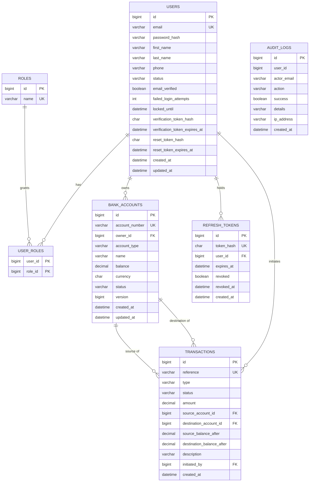

# SecureBank API

A secure banking REST API built as a modular monolith with Spring Boot 3.5, Spring Security, Spring Data JPA, MySQL 8 and JWT authentication.

## Contents

1. [Project overview](#1-project-overview)
2. [Technology stack](#2-technology-stack)
3. [Prerequisites](#3-prerequisites)
4. [Create the MySQL database](#4-create-the-mysql-database)
5. [Environment variables](#5-environment-variables)
6. [Import into NetBeans or IntelliJ](#6-import-into-netbeans-or-intellij)
7. [Build with Maven](#7-build-with-maven)
8. [Run the application](#8-run-the-application)
9. [API endpoints](#9-api-endpoints)
10. [Authenticate with JWT](#10-authenticate-with-jwt)
11. [Test with Postman](#11-test-with-postman)
12. [Default development setup](#12-default-development-setup)
13. [Database migrations](#13-database-migrations)
14. [Troubleshooting](#14-troubleshooting)
15. [Security architecture](#15-security-architecture)
16. [Automated tests](#16-automated-tests)
17. [Entity relationship diagram](#17-entity-relationship-diagram)
18. [Honest verification status](#18-honest-verification-status)

---

## 1. Project overview

SecureBank API lets users register, log in, open bank accounts, deposit, withdraw and transfer money, and review their transaction history. Administrators can list and suspend users, view all accounts, monitor all transactions and review audit logs.

Main design goals:

* Money is always `BigDecimal` (database type `DECIMAL(19,2)`), never `double` or `float`.
* Every balance change runs in one database transaction with row level locks, so double spending and lost updates are impossible.
* The identity of the caller always comes from the Spring Security context. A user id sent by a client is never used for authorization.
* Stateless JWT access tokens plus rotating, revocable refresh tokens stored only as hashes.
* No secret or credential is stored in the source code. Everything sensitive is read from environment variables.

Package layout (`za.co.securebank`):

| Package | Purpose |
|---|---|
| `config` | Security chain, CORS, OpenAPI, typed configuration properties, bootstrap runner |
| `controller` | Thin REST controllers (validation and delegation only) |
| `service` | All business logic and transaction boundaries |
| `repository` | Spring Data JPA repositories, locking queries, specifications |
| `entity` | JPA entities: User, Role, BankAccount, Transaction, RefreshToken, AuditLog |
| `dto.request` / `dto.response` | API contracts. Entities are never exposed |
| `security` | JWT service and filter, UserDetails, entry point, access denied handler, rate limiting |
| `exception` | Domain exceptions and the global exception handler |
| `enums` | Status and type enumerations |
| `mapper` | Entity to DTO mapping |
| `audit` | Audit logging service |
| `util`, `validation` | Money, token and masking helpers, password policy validator |

## 2. Technology stack

* Java 17 (no Java 21 features are used)
* Spring Boot 3.5.x, Maven
* Spring Security 6, Spring Data JPA (Hibernate 6), Jakarta Bean Validation
* MySQL 8 with Flyway migrations
* JJWT 0.12.6 (HS256 access tokens), BCrypt password hashing
* Lombok, Spring Boot Actuator, springdoc OpenAPI (Swagger UI)
* JUnit 5, Mockito, Spring Security Test, Testcontainers (MySQL), H2 (Docker free alternative), Maven Surefire

## 3. Prerequisites

* JDK 17 or newer installed and selected as the project JDK (the code is compiled with `release 17`)
* Apache Maven 3.8 or newer (NetBeans and IntelliJ bundle one)
* MySQL 8.0.16 or newer (CHECK constraints are only enforced from 8.0.16)
* Optional: Docker, only for the Testcontainers test
* Optional: Postman

## 4. Create the MySQL database

Log in to MySQL as an administrator and run the following. Choose your own strong password and use the same value in your `.env` file.

```sql
CREATE DATABASE securebank CHARACTER SET utf8mb4 COLLATE utf8mb4_0900_ai_ci;
CREATE USER 'securebank_user'@'localhost' IDENTIFIED BY 'choose_a_strong_password_here';
GRANT ALL PRIVILEGES ON securebank.* TO 'securebank_user'@'localhost';
FLUSH PRIVILEGES;
```

You do not create any tables. Flyway creates the schema automatically on first start.

## 5. Environment variables

Copy `.env.example` to `.env` in the project root and fill in the values. The application imports `.env` automatically when it is started from the project directory, which is what NetBeans and IntelliJ do for Maven projects. `.env` is listed in `.gitignore` and must never be committed.

| Variable | Required | Description |
|---|---|---|
| `DB_USERNAME` | yes | MySQL user |
| `DB_PASSWORD` | yes | MySQL password |
| `DB_HOST`, `DB_PORT`, `DB_NAME` | no | Default `localhost`, `3306`, `securebank` (dev). Required in prod |
| `JWT_SECRET` | yes | Base64 encoded signing key, at least 32 bytes before encoding |
| `JWT_ACCESS_TTL_MINUTES` | no | Access token lifetime, default 15 |
| `JWT_REFRESH_TTL_DAYS` | no | Refresh token lifetime, default 7 |
| `SPRING_PROFILES_ACTIVE` | no | `dev` (default) or `prod` |
| `CORS_ALLOWED_ORIGINS` | no | Comma separated list, default `http://localhost:3000` |
| `SECUREBANK_ADMIN_EMAIL`, `SECUREBANK_ADMIN_PASSWORD` | no | If both are set, an administrator is created on first start |
| `SERVER_PORT` | no | Default 8080 |

Generate a JWT secret:

```
openssl rand -base64 48
```

On Windows PowerShell:

```
$b = New-Object byte[] 48; [Security.Cryptography.RandomNumberGenerator]::Create().GetBytes($b); [Convert]::ToBase64String($b)
```

The application refuses to start if `JWT_SECRET` is missing, is not Base64, or is shorter than 256 bits.

The admin password must be at least 10 characters. Use a strong one, for example the same policy as users: upper case, lower case, digit and special character.

## 6. Import into NetBeans or IntelliJ

**NetBeans 20**

1. Unzip `SecureBank.zip`.
2. File, Open Project, select the `SecureBank` folder (it shows the Maven icon), Open.
3. Make sure the project JDK is 17 or newer: right click the project, Properties, Build, Compile, and check the Java platform. Under Tools, Java Platforms you can add a JDK 17.
4. Lombok: NetBeans 20 supports Lombok through annotation processing, which the `pom.xml` configures. If you see red underlines on getters or builders, right click the project, Clean and Build, then close and reopen the project. Annotation processing must be enabled under Project Properties, Build, Compile, "Enable Annotation Processing".
5. Create the `.env` file in the `SecureBank` folder (the folder that contains `pom.xml`).

**IntelliJ IDEA**

1. File, Open, select `pom.xml`, choose "Open as Project".
2. Set Project SDK to 17+ (File, Project Structure).
3. Install the Lombok plugin if it is missing and enable Settings, Build, Execution, Deployment, Compiler, Annotation Processors, "Enable annotation processing".
4. Create `.env` in the project root. In the Run Configuration make sure the working directory is the project root.

## 7. Build with Maven

```
mvn clean package
```

Skip tests when you only want the jar:

```
mvn clean package -DskipTests
```

In NetBeans: right click the project, Clean and Build.

## 8. Run the application

```
mvn spring-boot:run
```

Or run the jar:

```
java -jar target/securebank-api-1.0.0.jar
```

In NetBeans: right click the project, Run. Keep the working directory as the project folder so `.env` is found. If you prefer not to use `.env`, set the variables in your operating system or in the run configuration instead.

When it starts you will see Flyway apply `V1__create_schema` and `V2__seed_roles`, then Tomcat on port 8080.

* Swagger UI (dev only): http://localhost:8080/swagger-ui.html
* OpenAPI JSON (dev only): http://localhost:8080/v3/api-docs
* Health: http://localhost:8080/actuator/health

## 9. API endpoints

Base path `/api/v1`. All bodies are JSON. Money values are JSON numbers with at most two decimals. Errors always use this shape and never contain stack traces:

```json
{
  "timestamp": "2026-11-22T10:15:30.123Z",
  "status": 422,
  "error": "Unprocessable Entity",
  "message": "Insufficient funds",
  "path": "/api/v1/transactions/withdraw",
  "fieldErrors": [ { "field": "amount", "message": "..." } ]
}
```

`fieldErrors` only appears for validation errors (400).

### Authentication (public)

| Method | Path | Description | Success |
|---|---|---|---|
| POST | `/auth/register` | `email, password, firstName, lastName, phone?` | 201 user |
| POST | `/auth/login` | `email, password`. Returns access and refresh token | 200 |
| POST | `/auth/refresh` | `refreshToken`. Rotates: old token revoked, new pair returned | 200 |
| POST | `/auth/logout` | `refreshToken`. Revokes it | 200 |
| POST | `/auth/verify-email` | `token` from the verification email | 200 |
| POST | `/auth/forgot-password` | `email`. Always answers 200 with the same text | 200 |
| POST | `/auth/reset-password` | `token, newPassword`. Revokes all sessions | 200 |

Errors: 400 validation, 401 bad credentials or invalid refresh token, 403 suspended account or unverified email (prod), 409 duplicate email, 423 account locked, 429 rate limit exceeded.

### Users (ROLE_USER)

| Method | Path | Description |
|---|---|---|
| GET | `/users/me` | Own profile |
| PUT | `/users/me` | Update `firstName, lastName, phone` |

### Accounts (ROLE_USER, own accounts only)

| Method | Path | Description |
|---|---|---|
| POST | `/accounts` | Body `type` (`SAVINGS` or `CHECKING`), optional `name`. 201 |
| GET | `/accounts` | List own accounts |
| GET | `/accounts/{accountId}` | One account |
| GET | `/accounts/{accountId}/balance` | Balance |

An account that belongs to someone else returns 404, so its existence is not revealed. A user can own at most 5 accounts (`securebank.accounts.max-per-user`).

### Transactions (ROLE_USER)

| Method | Path | Description |
|---|---|---|
| POST | `/transactions/deposit` | `accountId, amount, description?`. 201 |
| POST | `/transactions/withdraw` | `accountId, amount, description?`. 201, 422 on insufficient funds |
| POST | `/transactions/transfer` | `sourceAccountId, destinationAccountNumber, amount, description?`. 201 |
| GET | `/transactions` | History. Query: `accountId, type, from, to, page, size` (dates `yyyy-MM-dd`, inclusive, South African time) |
| GET | `/transactions/{transactionId}` | One transaction that involves one of your accounts |

Transfers use the 10 digit account number of the destination because that is what a payer knows. The running balance in a transaction is only shown for accounts you own, so a receiver never sees the sender's balance.

### Administration (ROLE_ADMIN only)

| Method | Path | Description |
|---|---|---|
| GET | `/admin/users?page&size` | List users |
| GET | `/admin/users/{userId}` | User details |
| PATCH | `/admin/users/{userId}/suspend` | Suspend and revoke all sessions. Admins cannot suspend themselves |
| PATCH | `/admin/users/{userId}/activate` | Reactivate and clear lockout |
| GET | `/admin/accounts?page&size` | All bank accounts |
| GET | `/admin/transactions` | All transactions, same filters as the user history |
| GET | `/admin/audit-logs?userId&action&page&size` | Audit trail |

### HTTP status summary

200 OK, 201 Created, 400 validation or malformed request, 401 not authenticated or bad token, 403 forbidden, 404 not found (also for resources you do not own), 405 method not allowed, 409 conflict, 422 business rule (insufficient funds, frozen account, account limit), 423 locked, 429 too many requests, 500 unexpected (no details leaked).

## 10. Authenticate with JWT

1. Register:

```
curl -s -X POST http://localhost:8080/api/v1/auth/register -H "Content-Type: application/json" -d "{\"email\":\"alice@example.com\",\"password\":\"Str0ng!Passw0rd\",\"firstName\":\"Alice\",\"lastName\":\"Smith\"}"
```

2. Log in. The response contains `accessToken` (valid 15 minutes) and `refreshToken` (valid 7 days):

```
curl -s -X POST http://localhost:8080/api/v1/auth/login -H "Content-Type: application/json" -d "{\"email\":\"alice@example.com\",\"password\":\"Str0ng!Passw0rd\"}"
```

3. Call protected endpoints with the header `Authorization: Bearer <accessToken>`:

```
curl -s http://localhost:8080/api/v1/accounts -H "Authorization: Bearer <accessToken>"
```

4. When the access token expires (HTTP 401), call `POST /auth/refresh` with the refresh token. You receive a new access token and a new refresh token. The old refresh token stops working immediately. Presenting an already used refresh token is treated as theft and revokes every session of that user.
5. Call `POST /auth/logout` with the refresh token to end the session.

In Swagger UI, click Authorize and paste only the access token (without the word Bearer).

Password policy: 10 to 72 characters, with an upper case letter, a lower case letter, a digit and a special character, and no spaces.

## 11. Test with Postman

1. Import `postman/SecureBank.postman_collection.json` (File, Import).
2. The collection variable `baseUrl` defaults to `http://localhost:8080`.
3. Run requests in order from the top: Register, Login (the test script stores `accessToken` and `refreshToken` as collection variables), Create account (stores `accountId` and `accountNumber`), Deposit, Withdraw, Transfer, History.
4. The Refresh request updates both stored tokens automatically.
5. To try admin requests, start the application with `SECUREBANK_ADMIN_EMAIL` and `SECUREBANK_ADMIN_PASSWORD` set, then run "Admin login" (it stores `adminToken`) and use the Administration folder.

For a second user to test transfers, run "Register second user" and "Login second user", then create an account for that user and copy its account number into the transfer request.

## 12. Default development setup

* Profile `dev` is active unless `SPRING_PROFILES_ACTIVE` says otherwise.
* MySQL on `localhost:3306`, database `securebank`, credentials from `DB_USERNAME` and `DB_PASSWORD` (no defaults, so you must set them).
* Email is not sent. `LoggingEmailService` writes a log line only. In dev the verification and reset tokens are also logged at DEBUG level so you can complete those flows locally. This is disabled in every other profile.
* Email verification is not enforced in dev (`securebank.security.require-email-verification=false`). It is enforced in prod.
* No users exist at first. Register through the API. To get an administrator, set `SECUREBANK_ADMIN_EMAIL` and `SECUREBANK_ADMIN_PASSWORD` before the first start. There are no default credentials anywhere in the code.
* Account lockout: 5 consecutive failed logins lock the account for 15 minutes. An administrator can unlock it through the activate endpoint.
* Rate limit: 20 requests per minute per client address on `/api/v1/auth/**`.

## 13. Database migrations

Schema changes are managed only by Flyway (`src/main/resources/db/migration`). Hibernate is configured with `ddl-auto=none` and never changes the schema.

| Migration | Content |
|---|---|
| `V1__create_schema.sql` | All tables, primary keys, foreign keys, unique constraints, CHECK constraints (no negative balance, positive amounts, valid transaction shape) and indexes |
| `V2__seed_roles.sql` | `ROLE_USER` and `ROLE_ADMIN` |

Rules:

* Never edit a migration that has been applied. Add a new `V3__description.sql` instead.
* Flyway runs automatically on startup. To run it by hand: `mvn flyway:migrate` requires the Flyway Maven plugin, which this project does not include, so use the application start.
* To reset a development database: drop and recreate the `securebank` database, then start the application.
* If Flyway reports a checksum mismatch in development, you edited an applied migration. Drop the database and start again.

To switch on Hibernate schema validation in your environment add `spring.jpa.hibernate.ddl-auto=validate` to your local configuration. It is off by default so a small type mapping difference never blocks startup.

## 14. Troubleshooting

| Symptom | Cause and fix |
|---|---|
| `Could not resolve placeholder 'DB_USERNAME'` or `JWT_SECRET` | Variable not set. Create `.env` in the project root (where `pom.xml` is) and start from that directory, or set real environment variables |
| `JWT_SECRET must be a valid Base64 string` | Generate one with `openssl rand -base64 48`. Do not leave the example text |
| `JWT_SECRET must decode to at least 32 bytes` | The secret is too short. Generate a longer one |
| `Access denied for user` or `Communications link failure` | Wrong MySQL credentials, MySQL not running, or wrong host and port |
| `Unknown database 'securebank'` | Create the database (section 4) |
| `Flyway ... Migration checksum mismatch` | An applied migration was edited. In development drop the database and restart |
| `Role ROLE_USER is missing` | Flyway seeding did not run. Check the migrations ran, or restart (a startup runner also creates the roles) |
| Lombok errors such as `cannot find symbol getEmail()` in the IDE | Enable annotation processing, install the Lombok plugin, clean and rebuild |
| `release version 17 not supported` | Maven is running on an older JDK. Point `JAVA_HOME` at JDK 17 or newer |
| `Port 8080 was already in use` | Set `SERVER_PORT=8081` in `.env` |
| 401 on every request | Missing header or expired token. Format is `Authorization: Bearer <token>` |
| 403 on `/api/v1/admin/**` | The user is not an administrator |
| 423 on login | Account locked for 15 minutes after 5 failures, or ask an administrator to activate it |
| 429 on login | Rate limit reached. Wait one minute |
| 404 on an account you think exists | The account belongs to someone else. This is deliberate |
| Swagger UI not found | Swagger is disabled in the `prod` profile |
| Testcontainers test skipped | Docker is not running. See section 16 |
| `Unable to find a valid Docker environment` | Same as above, the test class is skipped automatically when Docker is missing |

## 15. Security architecture

**Request flow.** `RateLimitFilter` (auth endpoints only) then `JwtAuthenticationFilter` then the authorization rules in `SecurityFilterChain`, then `@PreAuthorize` on the controllers. Sessions are stateless and CSRF protection is disabled because the API uses bearer tokens and no cookies.

**Authentication.** Login uses an `AuthenticationManager` with a `DaoAuthenticationProvider`, a `CustomUserDetailsService` and a BCrypt `PasswordEncoder` (strength 12). `UserPrincipal` is the custom `UserDetails`. Wrong password and unknown email return the same message and status, which prevents account enumeration. Passwords are never logged, returned or stored in plain text.

**Access tokens.** HS256 JWTs with issuer, subject (email), id, roles, a unique `jti` and a 15 minute expiry. The signing key comes from `JWT_SECRET` and is validated at startup. On every request the user is reloaded from the database, so role changes, suspension and lockout take effect immediately even for unexpired tokens.

**Refresh tokens.** 256 bit random values. Only the SHA-256 hash is stored, so a database leak does not expose usable tokens. Tokens are single use: refreshing revokes the old one and issues a new one. Reuse of a revoked token revokes all sessions of the user and writes an audit entry. Logout, password reset and suspension revoke tokens. Expired tokens are purged nightly.

**Authorization.** URL rules: `/api/v1/auth/**` public, `/api/v1/admin/**` and non health actuator endpoints need `ROLE_ADMIN`, everything else under `/api/v1/**` needs authentication, anything unmapped is denied. Method level `@PreAuthorize` repeats the role check. Ownership is enforced inside queries (`findByIdAndOwnerId`), and the owner always comes from the security context, so a client supplied user id cannot grant access. Foreign resources answer 404.

**Account lockout and brute force.** 5 consecutive failures lock the account for 15 minutes (configurable). Failures are committed in their own transaction so they are not rolled back. A rate limiter (`RateLimiter` interface with an in memory implementation) throttles the authentication endpoints. To scale to several instances, supply a Redis or Bucket4j backed `RateLimiter` bean.

**Financial integrity.**

* `BigDecimal` and `DECIMAL(19,2)` everywhere. Amounts with more than two decimals are rejected instead of rounded.
* `@Transactional` on every operation. Deposits and withdrawals take a pessimistic write lock on the account row (`SELECT ... FOR UPDATE`). Transfers lock both accounts in ascending id order, which prevents deadlocks between opposite transfers. A `version` column adds optimistic locking as a second safeguard.
* A transfer is one transaction row and two balance updates committed together or not at all.
* Database CHECK constraints reject negative balances, non positive amounts and malformed transaction rows even if application code were bypassed.
* Every transaction has a unique reference (`TXN-...`).

**Auditing and safe logging.** `AuditService` records registrations, logins, failures, lockouts, token reuse, profile changes, account creation, transactions, rejected transactions, suspensions and access denied events with actor, IP and time. Details contain references and masked account numbers only, never passwords, tokens or amounts. Audit rows have no foreign key to users so they survive user removal and never lock user rows.

**Errors.** `GlobalExceptionHandler` maps every exception to one JSON shape. Unexpected errors return a generic 500 message while details go to the server log only. `server.error.include-*` is set to `never`.

**Other protections.** Input validation with Jakarta Bean Validation on every request body, password policy, CORS restricted to configured origins with no credentials, frame and content type sniffing headers, no secrets in source control, production profile with TLS to the database, Swagger disabled and email verification enforced.

**Email verification and password reset.** Tokens are random, stored as SHA-256 hashes with expiry (24 hours and 30 minutes) and are single use. `EmailService` is an interface. The default implementation only logs. Replace it with an SMTP implementation for production. The forgot password endpoint always answers the same way.

## 16. Automated tests

Run everything:

```
mvn test
```

| Test class | Type | Covers |
|---|---|---|
| `JwtServiceTest` | unit | valid, expired, tampered, wrong key, wrong issuer, bad secret |
| `StrongPasswordValidatorTest`, `MoneyUtilsTest`, `InMemoryRateLimiterTest` | unit | password policy, money rules, rate limiting |
| `AuthServiceTest` | Mockito | registration, login, invalid password, lockout and suspension mapping, verification, password reset |
| `LoginAttemptServiceTest`, `RefreshTokenServiceTest` | Mockito | lockout logic, token rotation and reuse detection |
| `AccountServiceTest`, `TransactionServiceTest` | Mockito | ownership, deposit, withdraw, insufficient balance, transfer, lock ordering |
| `AuthIntegrationTest` | Spring + MockMvc | full auth flows, refresh, logout, profile, verification, reset |
| `SecurityAuthorizationIntegrationTest` | Spring + MockMvc | 401 and 403 rules, tampered and expired tokens, admin endpoints, suspension |
| `AccountIntegrationTest`, `TransactionIntegrationTest` | Spring + MockMvc | account ownership, deposits, withdrawals, transfers, history filters |
| `ConcurrencyIntegrationTest` | Spring | parallel withdrawals cannot overdraw, opposite transfers do not deadlock |
| `RateLimitIntegrationTest` | Spring + MockMvc | HTTP 429 on auth endpoints |
| `MySqlContainerIntegrationTest` | Testcontainers | real Flyway migrations, CHECK constraints and concurrency on MySQL 8 |

**Test database.** The integration tests use the `test` profile (`application-test.properties`): an in memory H2 database in MySQL mode, schema created by Hibernate, test only JWT secret. This needs no Docker and no MySQL.

**Testcontainers.** `MySqlContainerIntegrationTest` starts a real MySQL 8 container and applies the Flyway scripts. It is skipped automatically when Docker is not available (`disabledWithoutDocker = true`). With Docker Desktop running, `mvn test` runs it too.

**Alternative without Docker.** Nothing to do, the H2 based tests run by default. If you have a local MySQL and want to run the integration tests against it instead, start the tests with `-Dspring.profiles.active=dev` and the `DB_*` and `JWT_SECRET` variables set to a throwaway test database (never your real data, the tests delete all rows).

## 17. Entity relationship diagram



`AUDIT_LOGS.user_id` is deliberately not a foreign key (see the security section).

## 18. Honest verification status

This archive was generated in an environment that had no access to Maven Central, so the dependencies could not be downloaded. As a result the project **was not compiled with Maven and the automated tests were not executed** in that environment. Only a syntax level parse of all Java files was possible. Please run `mvn clean test` on your machine as the first step. If anything fails to compile or a test fails, the error output will point to the exact line, and these are the most likely places to check: Lombok setup in the IDE, the JDK version, and the Docker based test (skipped without Docker).
